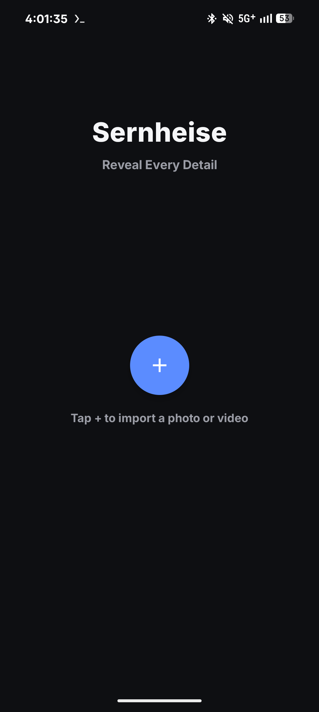
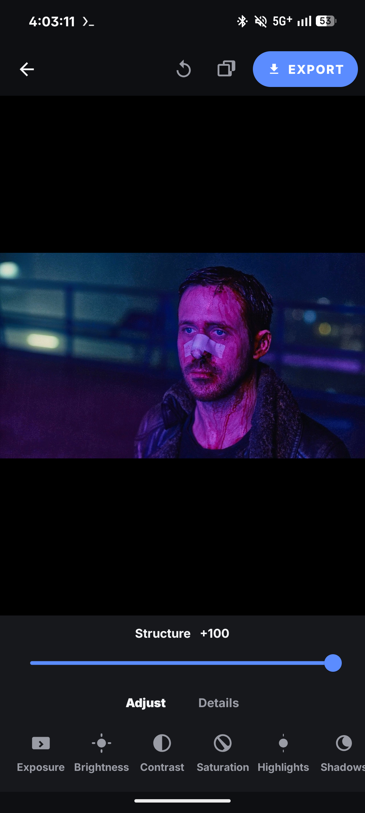

# Sernheise

A focused Android photo & video editor built around one core feature that's hard to find
on Android: a **Structure** (clarity/local-contrast) effect, alongside Sharpen and the
standard tonal adjustments — Exposure, Brightness, Contrast, Saturation, Highlights,
Shadows, Temperature, Tint.

## Screenshots

<p align="center">
  
  
  
</p>

## Stack
- Kotlin, single-activity-per-screen (`MainActivity` → `EditorActivity`)
- Custom OpenGL ES 2.0 rendering pipeline (`com.sernheise.app.gl`) — one shared shader
  drives both the live preview and full-resolution export, for images and video alike
- Live video preview via `SurfaceTexture` + `MediaPlayer`
- Video export via a manual decode → GL-filter → encode → mux pipeline
  (`com.sernheise.app.video.VideoExporter`), audio copied through untouched
- No third-party image/video filter library — the whole pipeline is self-contained

## Opening the project
1. Open the `Sernheise/` folder in Android Studio (Koala or newer recommended).
2. Let Gradle sync (needs network access once, to fetch AndroidX/Material).
3. Run on a device or emulator with API 26+.

## Structure
```
app/src/main/java/com/sernheise/app/
  MainActivity.kt        – "+" import screen
  EditorActivity.kt       – editor screen: preview, tools, export
  gl/                      – shader source, renderer, preview view, adjustments model
  video/                   – EGL core + frame-accurate video exporter
  ui/                      – tool catalog + RecyclerView adapter
  utils/                   – media loading & gallery export helpers
```

## Notes
- `minSdk` is 26 (required for `MediaCodec.createInputSurface()` reliability and the
  adaptive-icon-only resource set).
- The Structure and Sharpen effects are both single-pass unsharp-mask variants applied
  directly in the fragment shader (`SernShaders.kt`) — Structure samples a wider radius
  for broad clarity, Sharpen samples immediate neighbors for fine edge detail.
